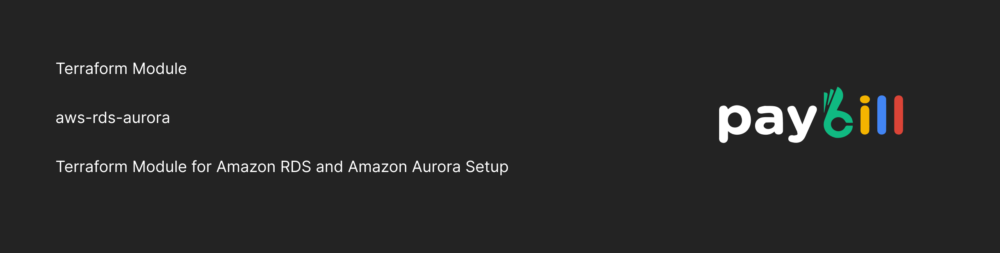

  <a href="https://paybill.dev" target="_blank">
    <picture>
      
    </picture>
  </a>

# Terraform AWS Aurora Database Module

This Terraform module provisions a fully managed **Amazon Aurora database cluster** (PostgreSQL or MySQL) along with associated networking, security, and configuration resources. It is designed for use in a structured AWS environment with VPCs, subnets, and tagging standards.

## Features

* **Aurora Cluster Deployment**

  * Creates an Aurora cluster with configurable engine type, engine version, instance type, and cluster size.
  * Supports both **provisioned** and **serverless v2** modes.
  * Optional **performance insights** and IAM-based authentication.

* **Networking Integration**

  * Automatically fetches VPC, public, and private subnets based on environment tags.
  * Attaches the Aurora cluster to the specified private subnets.

* **Security**

  * Creates and configures a **security group** for Aurora with additional customizable inbound rules.
  * Automatically allows access from the VPC CIDR and any additional rules provided.

* **Database Credentials Management**

  * Generates a **secure random password** for the Aurora admin user.
  * Stores database credentials and connection details securely in **AWS SSM Parameter Store**.

* **Tagging and Resource Metadata**

  * All resources are tagged with environment and project information via a centralized tagging module.

* **Outputs for Easy Integration**

  * Provides Aurora endpoints (master, reader, and cluster), ARNs, security groups, and replica hosts.
  * Enables other Terraform modules or applications to easily reference Aurora resources.

<!-- BEGIN_TF_DOCS -->
## Requirements

| Name | Version |
|------|---------|
|  [terraform](#requirement\_terraform) | >= 1.3.0 |
|  [aws](#requirement\_aws) | >= 5.0.0 |

## Providers

| Name | Version |
|------|---------|
|  [aws](#provider\_aws) | >= 5.0.0 |

## Modules

| Name | Source | Version |
|------|--------|---------|
|  [aurora](#module\_aurora) | ./modules/rds-aurora | n/a |
|  [db\_password](#module\_db\_password) | git::https://github.com/paybilldev/terraform-random-string | v1 |
|  [db\_ssm\_parameters](#module\_db\_ssm\_parameters) | git::https://github.com/paybilldev/terraform-aws-ssm-parameter | v1 |
|  [tags](#module\_tags) | git::https://github.com/paybilldev/terraform-tags | v1 |

## Resources

| Name | Type |
|------|------|
| [aws_security_group_rule.additional_inbound_rules](https://registry.terraform.io/providers/hashicorp/aws/latest/docs/resources/security_group_rule) | resource |
| [aws_caller_identity.current](https://registry.terraform.io/providers/hashicorp/aws/latest/docs/data-sources/caller_identity) | data source |
| [aws_partition.this](https://registry.terraform.io/providers/hashicorp/aws/latest/docs/data-sources/partition) | data source |
| [aws_security_groups.aurora](https://registry.terraform.io/providers/hashicorp/aws/latest/docs/data-sources/security_groups) | data source |
| [aws_subnets.private](https://registry.terraform.io/providers/hashicorp/aws/latest/docs/data-sources/subnets) | data source |
| [aws_subnets.public](https://registry.terraform.io/providers/hashicorp/aws/latest/docs/data-sources/subnets) | data source |
| [aws_vpc.vpc](https://registry.terraform.io/providers/hashicorp/aws/latest/docs/data-sources/vpc) | data source |

## Inputs

| Name | Description | Type | Default | Required |
|------|-------------|------|---------|:--------:|
|  [additional\_inbound\_rules](#input\_additional\_inbound\_rules) | ################################################################################# # Security Group ################################################################################# | <pre>list(object({     description       = string     from_port         = number     to_port           = number     protocol          = string     cidr_blocks       = list(string)     security_group_id = optional(list(string))     ipv6_cidr_blocks  = optional(list(string))    }))</pre> | `[]` | no |
|  [aurora\_allow\_major\_version\_upgrade](#input\_aurora\_allow\_major\_version\_upgrade) | Enable to allow major engine version upgrades when changing engine versions. Defaults to false. | `bool` | `false` | no |
|  [aurora\_auto\_minor\_version\_upgrade](#input\_aurora\_auto\_minor\_version\_upgrade) | Indicates that minor engine upgrades will be applied automatically to the DB instance during the maintenance window | `bool` | `true` | no |
|  [aurora\_cluster\_enabled](#input\_aurora\_cluster\_enabled) | Enable creation of an Aurora Cluster | `bool` | `true` | no |
|  [aurora\_cluster\_family](#input\_aurora\_cluster\_family) | The family of the DB cluster parameter group | `string` | `"aurora-postgresql15"` | no |
|  [aurora\_cluster\_size](#input\_aurora\_cluster\_size) | Number of DB instances to create in the cluster | `number` | `1` | no |
|  [aurora\_db\_admin\_username](#input\_aurora\_db\_admin\_username) | Name of the default DB admin user role | `string` | `""` | no |
|  [aurora\_db\_name](#input\_aurora\_db\_name) | Database name. | `string` | `"auroradb"` | no |
|  [aurora\_db\_port](#input\_aurora\_db\_port) | Port for the Aurora DB instance to use. | `number` | `5432` | no |
|  [aurora\_engine](#input\_aurora\_engine) | The name of the database engine to be used for this DB cluster. Valid values: `aurora`, `aurora-mysql`, `aurora-postgresql` | `string` | `"aurora-postgresql"` | no |
|  [aurora\_engine\_mode](#input\_aurora\_engine\_mode) | The database engine mode. Valid values: `parallelquery`, `provisioned`, `serverless` | `string` | `"provisioned"` | no |
|  [aurora\_engine\_version](#input\_aurora\_engine\_version) | The version of the database engine tocl use. See `aws rds describe-db-engine-versions` | `string` | `"16.6"` | no |
|  [aurora\_instance\_type](#input\_aurora\_instance\_type) | Instance type to use | `string` | `"db.t3.medium"` | no |
|  [aurora\_iops](#input\_aurora\_iops) | The amount of provisioned IOPS. Setting this implies a storage\_type of 'io1'. This setting is required to create a Multi-AZ DB cluster. Check TF docs for values based on db engine | `number` | `null` | no |
|  [aurora\_serverlessv2\_scaling\_configuration](#input\_aurora\_serverlessv2\_scaling\_configuration) | serverlessv2 scaling properties | <pre>object({     min_capacity = number     max_capacity = number   })</pre> | `null` | no |
|  [aurora\_storage\_type](#input\_aurora\_storage\_type) | One of 'standard' (magnetic), 'gp2' (general purpose SSD), or 'io1' (provisioned IOPS SSD) or aurora-iopt1 | `string` | `null` | no |
|  [deletion\_protection](#input\_deletion\_protection) | Protect the instance from being deleted | `bool` | `false` | no |
|  [environment](#input\_environment) | ID element. Usually used for region e.g. 'uw2', 'us-east-1', OR role 'prod', 'staging', 'dev', 'UAT' | `string` | n/a | yes |
|  [iam\_database\_authentication\_enabled](#input\_iam\_database\_authentication\_enabled) | Specifies whether or mappings of AWS Identity and Access Management (IAM) accounts to database accounts is enabled | `bool` | `false` | no |
|  [namespace](#input\_namespace) | Namespace for the resources. | `string` | n/a | yes |
|  [performance\_insights\_enabled](#input\_performance\_insights\_enabled) | Whether to enable Performance Insights | `bool` | `false` | no |
|  [performance\_insights\_retention\_period](#input\_performance\_insights\_retention\_period) | Amount of time in days to retain Performance Insights data. Either 7 (7 days) or 731 (2 years) | `number` | `null` | no |
|  [region](#input\_region) | AWS region | `string` | `"us-east-1"` | no |
|  [timeouts](#input\_timeouts) | A list of DB timeouts to apply to the running code while creating, updating, or deleting the DB instance. | <pre>object({     create = string     update = string     delete = string   })</pre> | <pre>{   "create": "40m",   "delete": "60m",   "update": "80m" }</pre> | no |

## Outputs

| Name | Description |
|------|-------------|
|  [aurora\_arns](#output\_aurora\_arns) | Amazon Resource Name (ARN) of cluster |
|  [aurora\_endpoints](#output\_aurora\_endpoints) | The DNS address of the Aurora instance |
|  [aurora\_master\_host](#output\_aurora\_master\_host) | DB Master hostname |
|  [aurora\_reader\_endpoint](#output\_aurora\_reader\_endpoint) | A read-only endpoint for the Aurora cluster, automatically load-balanced across replicas |
|  [aurora\_replicas\_host](#output\_aurora\_replicas\_host) | Replicas hostname |
|  [aurora\_security\_group](#output\_aurora\_security\_group) | Security groups that are allowed to access the RDS |
<!-- END_TF_DOCS -->